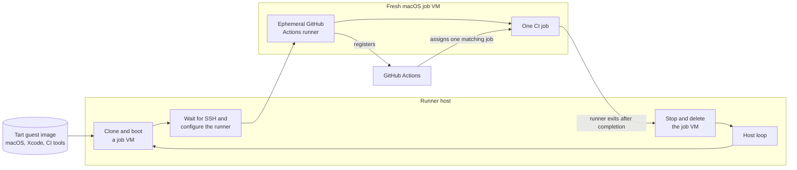

# tartelette

Ephemeral macOS GitHub Actions runners on Apple Silicon, inspired by
[ekiden](https://github.com/mirego/ekiden).

Each CI job runs in a fresh [Tart](https://tart.run) VM cloned from a custom
macOS + Xcode image. The VM registers as an **ephemeral** runner, runs exactly
one job, then is destroyed.

## Quick start

```sh
brew install mise hudochenkov/sshpass/sshpass
git clone <this-repo> && cd tartelette
mise trust && mise install

mise run vm:build                     # build the guest image (Xcode 26.3)
cp .env.example .env && $EDITOR .env  # fill auth + image name
mise run runners:start                # start the runner loop
```

- [Setup](docs/setup.md) — prerequisites, `.env` config, auth options
- [Building](docs/building.md) — image variants, multi-host distribution
- [Running](docs/running.md) — parallel runners, drain, LaunchDaemon, observability
- [Troubleshooting](docs/troubleshooting.md)

## How it works

The host loop clones a fresh VM from the guest image, registers it with GitHub
as an ephemeral runner, waits for a job to run, then destroys the VM — one VM
per job, every time. See [Running](docs/running.md) for parallel runners,
graceful shutdown, and log format.



The guest image is reused; each running VM is not. A completed job consumes
its runner and its clone, so the next job starts from the known image again.

## Tasks

| Task | Does |
|------|------|
| `mise run vm:build [--xcode <tag>]` | build the guest image with Packer |
| `mise run vm:list` | list VMs in the local Tart store |
| `mise run vm:versions` | list stable Xcode versions available to build |
| `mise run vm:copy <dest> <vm>` | rsync a built image to another host or path |
| `mise run runners:start` | start a single host loop |
| `mise run runners:parallel [N]` | run N loops in parallel (default 2) |
| `mise run runners:drain` | signal loops to stop after current job |
| `mise run runners:list` | list runners registered on GitHub for this repo/org |
| `mise run runners:daemon:install [N]` | install a per-user LaunchAgent that runs `runners:parallel` at login |
| `mise run runners:daemon:status` | show agent state, pid, and recent log |
| `mise run runners:daemon:logs` | follow the daemon log (`tail -f`) |
| `mise run runners:daemon:stop` | unload + disable the agent (keeps the plist) |
| `mise run runners:daemon:start` | re-enable and (re)start the agent |
| `mise run runners:daemon:uninstall` | stop and remove the LaunchAgent |
| `mise run runners:clean [--offline-only]` | deregister orphan runners on GitHub |
| `mise run vm:clean [-y]` | delete dead job-VM clones from the Tart store |
